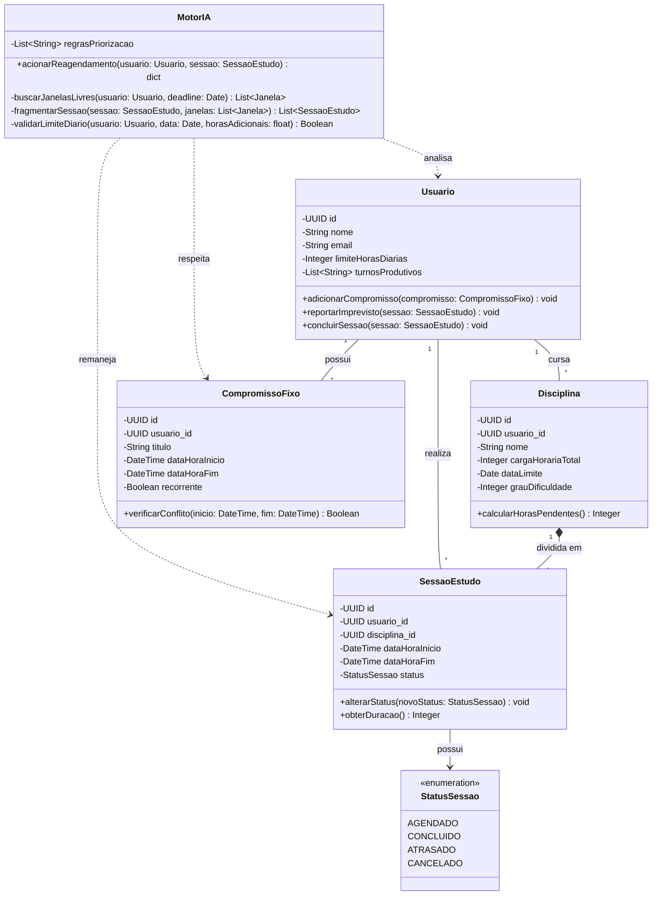
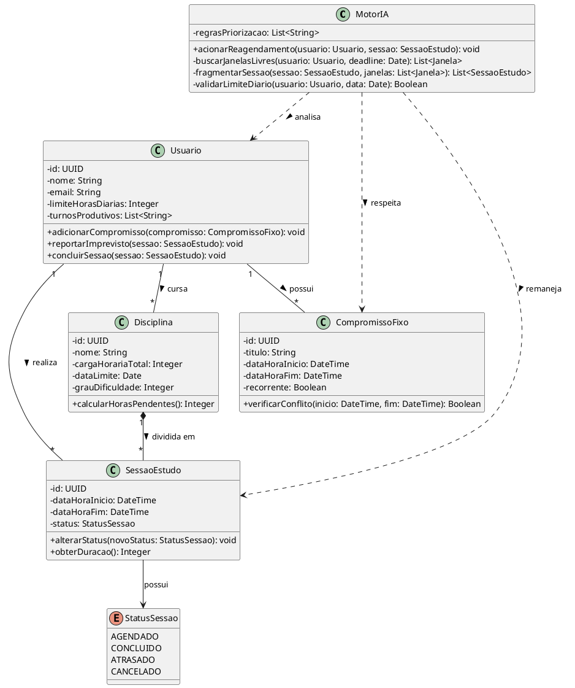
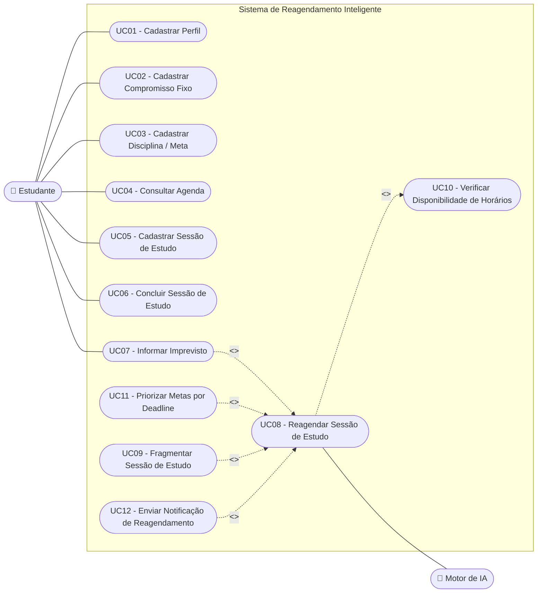
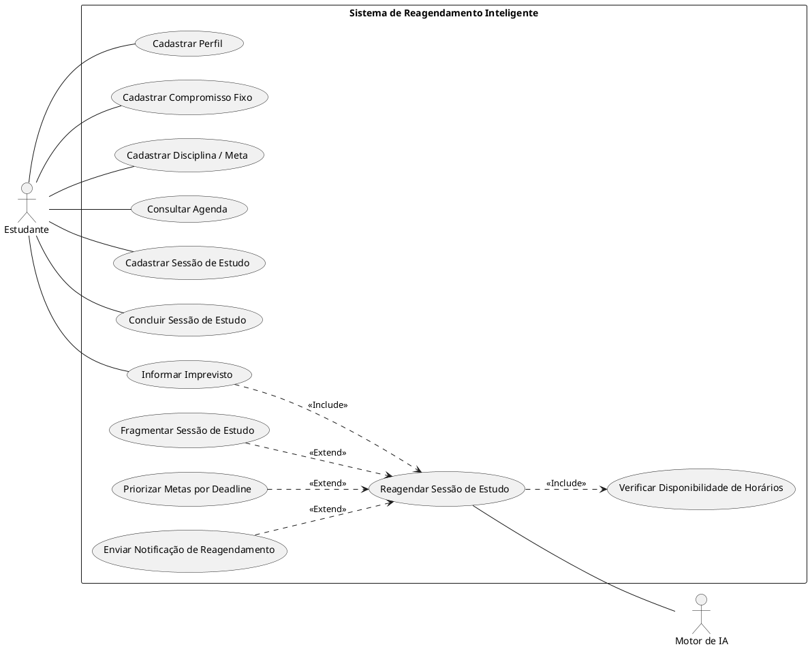
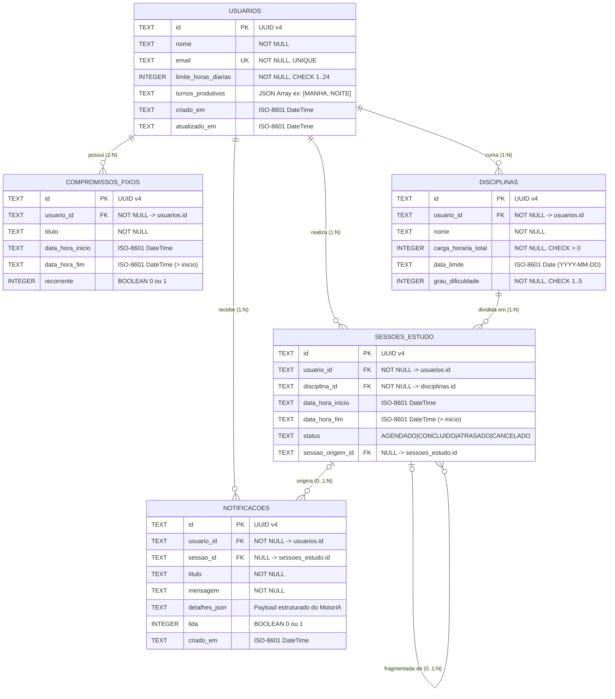

# MRDS — Modelo de Requisitos e Documentação de Sistemas
## Sistema de Reagendamento Inteligente

**Autores:** Davi Aires Bastos Medeiros e Yuri da Silva Araújo  
**Curso / Turma:** Análise e Desenvolvimento de Sistemas (4ADS)  
**Tecnologia Alvo (RAD):** Python 3 + Streamlit + SQLite  
**Versão:** 1.0

---

## 1. Visão Geral e Mini Mundo

### 1.1 Mini Mundo
O **Sistema de Reagendamento Inteligente** atua como um assistente autônomo de gestão de tempo, projetado para resolver o problema comum do planejamento rígido. Quando um estudante perde um bloco de estudo devido a um imprevisto, o sistema utiliza Inteligência Artificial para analisar a rotina restante, os prazos e as prioridades, reorganizando a agenda de forma realista sem sobrecarregar o usuário.

### 1.2 Dinâmica e Fluxo Principal
1. O estudante insere suas aulas e horários de trabalho (**Compromissos Fixos**).
2. O estudante adiciona que precisa estudar **"Banco de Dados"** (4 horas totais) até sexta-feira.
3. O sistema aloca dois blocos de 2 horas na terça-feira e na quinta-feira.
4. Na terça-feira, o estudante tem um imprevisto e não consegue estudar. Ele marca a sessão como **Atrasada** (ou aciona **"Tive um imprevisto"**).
5. O **Motor de IA** entra em ação: avalia que faltam 4 horas de estudo até sexta-feira, verifica a agenda de quarta e quinta-feira, cruza com os limites de cansaço diário e divide as horas pendentes em novos blocos menores encaixados nos espaços vazios otimizados.
6. O estudante recebe uma **notificação** com a nova rota de estudos calculada.

---

## 2. Atores do Sistema

| Ator | Tipo | Descrição |
| :--- | :--- | :--- |
| **Estudante** | Principal | Usuário principal que cadastra sua rotina fixa, insere as disciplinas que precisa estudar, define prazos (provas, entregas) e reporta ao sistema quando um imprevisto acontece ou quando conclui um estudo. |
| **Motor de IA** | Principal (Autônomo) | Processo assíncrono em background que atua como o "cérebro" do sistema. Ele lê os dados do calendário, avalia o impacto de um estudo não realizado e propõe ou executa o remanejamento automático dos blocos futuros. |
| **Sistema** | Suporte / Notificação | Responsável por consolidar as alterações na persistência e disparar notificações ao estudante após o reagendamento (UC12). |

---

## 3. Entidades Principais

- **Usuário (`Usuario` / Perfil):** Armazena dados básicos (`id`, `nome`, `email`) e preferências de estudo (`limiteHorasDiarias`, `turnosProdutivos`, ex.: `["MANHA", "NOITE"]`).
- **Compromisso Fixo (`CompromissoFixo` / Rotina):** Eventos imutáveis no calendário do usuário (ex.: horário de trabalho, aulas da faculdade, compromissos pessoais). Estes blocos são "zonas proibidas" para agendamento de estudos.
- **Disciplina / Meta de Estudo (`Disciplina`):** A matéria que precisa ser estudada, contendo grau de dificuldade (1 a 5), carga horária total necessária e uma data limite (*deadline*).
- **Sessão de Estudo (`SessaoEstudo`):** Um bloco de tempo específico alocado na agenda (ex.: `"Banco de Dados - 14h às 16h"`). Possui o enumerador `StatusSessao`: `AGENDADO`, `CONCLUIDO`, `ATRASADO` ou `CANCELADO`.

---

## 4. Regras de Negócio (RN01 a RN05)

| Código | Nome | Especificação |
| :--- | :--- | :--- |
| **RN01** | **Bloqueio de Conflitos** | Nenhuma `SessaoEstudo` pode ser agendada ou reagendada sobrepondo um `CompromissoFixo` ou outra sessão de estudo já agendada. |
| **RN02** | **Gatilho de Reagendamento** | O reagendamento pelo `MotorIA` é acionado automaticamente quando o horário de término de uma `SessaoEstudo` passa e seu status não foi marcado como `CONCLUIDO`, ou manualmente quando o estudante aciona a opção **"Tive um imprevisto"**. |
| **RN03** | **Priorização por Prazo (Deadline)** | Ao reagendar, o `MotorIA` deve dar prioridade máxima às disciplinas/metas cujas `dataLimite` estão mais próximas, utilizando `grauDificuldade` como critério de desempate (maior dificuldade primeiro). |
| **RN04** | **Fragmentação de Blocos** | Se o `MotorIA` não encontrar uma janela livre contínua com a duração total da sessão original (ex.: 2 horas), ele tem permissão para fragmentar a sessão em blocos menores (ex.: dois blocos de 1 hora) distribuídos em horários/dias disponíveis antes do *deadline*. |
| **RN05** | **Limite de Carga Diária** | O `MotorIA` nunca pode agendar ou reagendar sessões se a soma de horas de estudo daquele dia ultrapassar o `limiteHorasDiarias` máximo tolerável definido no perfil do estudante, evitando o *burnout*. |

---

## 5. Diagrama de Classes

### 5.1 Diagrama de Classes — Mermaid.js

### 5.2 Diagrama de Classes — PlantUML

---

## 6. Lista e Diagrama de Casos de Uso

### 6.1 Lista de Casos de Uso
- **UC01** - Cadastrar Perfil
- **UC02** - Cadastrar Compromisso Fixo
- **UC03** - Cadastrar Disciplina/Meta de Estudo
- **UC04** - Consultar Agenda
- **UC05** - Cadastrar Sessão de Estudo
- **UC06** - Concluir Sessão de Estudo
- **UC07** - Informar Imprevisto
- **UC08** - Reagendar Sessão de Estudo
- **UC09** - Fragmentar Sessão de Estudo
- **UC10** - Verificar Disponibilidade de Horários
- **UC11** - Priorizar Metas por Deadline
- **UC12** - Enviar Notificação de Reagendamento

### 6.2 Diagrama de Casos de Uso — Mermaid.js

### 6.3 Diagrama de Casos de Uso — PlantUML

---

## 7. Modelo Entidade-Relacionamento (DER / MER Lógico e Físico)

### 7.1 DER / MER — Mermaid.js

### 7.2 Dicionário de Dados Físico (Resumo)
O script DDL completo encontra-se no arquivo [`database_schema.sql`](./database_schema.sql), contendo todas as tabelas, chaves primárias UUID, chaves estrangeiras com `ON DELETE CASCADE`, restrições `CHECK` (integridade temporal, faixa de dificuldade, valores válidos do enum `StatusSessao`), índices de performance e a visão `vw_progresso_disciplinas`.

---

## 8. Especificação Detalhada dos Casos de Uso (UC01 a UC12)

### Identificação: UC01
- **Nome:** Cadastrar Perfil
- **Ator principal:** Estudante
- **Objetivo:** Permitir que o estudante cadastre suas informações e preferências de estudo no sistema.
- **Pré-condições:** O estudante deve ter acesso ao sistema.
- **Pós-condições:** O perfil do estudante fica cadastrado e suas preferências de estudo ficam disponíveis para serem utilizadas pelo sistema.
- **Gatilho:** O estudante seleciona a opção de cadastro de perfil.
- **Fluxo principal:**
  1. O estudante acessa a opção de cadastro de perfil.
  2. O sistema apresenta o formulário de cadastro.
  3. O estudante informa seus dados pessoais e suas preferências de estudo.
  4. O estudante informa seu limite máximo de horas de estudo diário.
  5. O estudante informa seus horários de maior produtividade, caso deseje.
  6. O estudante confirma o cadastro.
  7. O sistema valida as informações fornecidas.
  8. O sistema registra o perfil do estudante.
  9. O sistema confirma o cadastro.
- **Fluxo alternativo:** Caso o estudante informe algum dado inválido ou deixe um campo obrigatório vazio, o sistema informa o problema e solicita a correção dos dados. Após a correção, o estudante pode tentar realizar o cadastro novamente.
- **Regras de negócio relacionadas:** RN05, que define o limite de carga diária de estudos.

---

### Identificação: UC02
- **Nome:** Cadastrar Compromisso Fixo
- **Ator principal:** Estudante
- **Objetivo:** Permitir que o estudante cadastre na agenda seus compromissos fixos, como aulas, trabalho e compromissos pessoais.
- **Pré-condições:** O estudante deve possuir um perfil cadastrado no sistema.
- **Pós-condições:** O compromisso fixo fica registrado na agenda do estudante e passa a ser considerado pelo sistema durante o planejamento das sessões de estudo.
- **Gatilho:** O estudante seleciona a opção de cadastrar um compromisso fixo.
- **Fluxo principal:**
  1. O estudante acessa a opção de cadastro de compromisso fixo.
  2. O sistema apresenta o formulário de cadastro.
  3. O estudante informa o nome do compromisso.
  4. O estudante informa o dia e o horário em que o compromisso ocorre.
  5. O estudante informa a duração do compromisso.
  6. O estudante confirma o cadastro.
  7. O sistema verifica as informações fornecidas.
  8. O sistema registra o compromisso fixo na agenda.
  9. O sistema confirma o cadastro.
- **Fluxo alternativo:** Caso o horário informado entre em conflito com outro compromisso fixo já cadastrado, o sistema informa o conflito e solicita que o estudante altere os dados antes de concluir o cadastro.
- **Regras de negócio relacionadas:** RN01, que determina que os compromissos fixos devem ser considerados como horários indisponíveis para o agendamento de sessões de estudo.

---

### Identificação: UC03
- **Nome:** Cadastrar Disciplina/Meta de Estudo
- **Ator principal:** Estudante
- **Objetivo:** Permitir que o estudante cadastre uma disciplina ou meta de estudo, informando as informações necessárias para o planejamento das sessões.
- **Pré-condições:** O estudante deve possuir um perfil cadastrado no sistema.
- **Pós-condições:** A disciplina ou meta de estudo fica registrada no sistema e pode ser utilizada no planejamento da agenda.
- **Gatilho:** O estudante seleciona a opção de cadastrar uma disciplina ou meta de estudo.
- **Fluxo principal:**
  1. O estudante acessa a opção de cadastro de disciplina ou meta de estudo.
  2. O sistema apresenta o formulário de cadastro.
  3. O estudante informa o nome da disciplina ou meta.
  4. O estudante informa o grau de dificuldade.
  5. O estudante informa a quantidade de horas necessárias para o estudo.
  6. O estudante informa a data limite para concluir a meta.
  7. O estudante confirma o cadastro.
  8. O sistema valida as informações.
  9. O sistema registra a disciplina ou meta de estudo.
  10. O sistema confirma o cadastro.
- **Fluxo alternativo:** Caso alguma informação obrigatória esteja ausente ou seja inválida, o sistema informa o problema e solicita que o estudante corrija os dados antes de concluir o cadastro.

---

### Identificação: UC04
- **Nome:** Consultar Agenda
- **Ator principal:** Estudante
- **Objetivo:** Permitir que o estudante visualize seus compromissos fixos e sessões de estudo cadastradas na agenda.
- **Pré-condições:** O estudante deve possuir um perfil cadastrado no sistema.
- **Pós-condições:** A agenda é apresentada ao estudante com as informações disponíveis para o período consultado.
- **Gatilho:** O estudante acessa a opção de consultar a agenda.
- **Fluxo principal:**
  1. O estudante acessa a agenda.
  2. O sistema apresenta os compromissos e sessões de estudo cadastrados.
  3. O estudante seleciona o período que deseja consultar.
  4. O sistema atualiza a agenda conforme o período selecionado.
  5. O estudante visualiza os horários disponíveis, compromissos fixos e sessões de estudo.
- **Fluxo alternativo:** Caso não existam compromissos ou sessões de estudo cadastrados para o período selecionado, o sistema informa que não há atividades registradas para aquele período.

---

### Identificação: UC05
- **Nome:** Cadastrar Sessão de Estudo
- **Ator principal:** Estudante
- **Objetivo:** Permitir que o estudante cadastre uma sessão de estudo vinculada a uma disciplina ou meta de estudo.
- **Pré-condições:** O estudante deve possuir uma disciplina ou meta de estudo cadastrada.
- **Pós-condições:** A sessão de estudo fica registrada na agenda com seu horário e duração.
- **Gatilho:** O estudante seleciona a opção de cadastrar uma sessão de estudo.
- **Fluxo principal:**
  1. O estudante acessa a opção de cadastrar uma sessão de estudo.
  2. O sistema apresenta as disciplinas e metas de estudo cadastradas.
  3. O estudante seleciona a disciplina ou meta relacionada à sessão.
  4. O estudante informa a data e o horário da sessão.
  5. O estudante informa a duração da sessão.
  6. O estudante confirma o cadastro.
  7. O sistema verifica se o horário está disponível.
  8. O sistema registra a sessão de estudo na agenda.
  9. O sistema define o status da sessão como `"Agendado"`.
  10. O sistema confirma o cadastro.
- **Fluxo alternativo:** Caso o horário escolhido esteja ocupado por um compromisso fixo ou outra sessão de estudo, o sistema informa o conflito e solicita que o estudante escolha outro horário.
- **Regras de negócio relacionadas:** RN01, que impede o agendamento de sessões de estudo sobre compromissos fixos.

---

### Identificação: UC06
- **Nome:** Concluir Sessão de Estudo
- **Ator principal:** Estudante
- **Objetivo:** Permitir que o estudante informe ao sistema que realizou uma sessão de estudo agendada.
- **Pré-condições:** O estudante deve possuir uma sessão de estudo cadastrada com status `"Agendado"`.
- **Pós-condições:** A sessão de estudo passa a ter o status `"Concluído"` e deixa de ser considerada uma sessão pendente pelo sistema.
- **Gatilho:** O estudante seleciona a opção de concluir uma sessão de estudo.
- **Fluxo principal:**
  1. O estudante acessa sua agenda.
  2. O estudante seleciona uma sessão de estudo agendada.
  3. O estudante seleciona a opção de concluir a sessão.
  4. O sistema solicita a confirmação da conclusão.
  5. O estudante confirma a conclusão.
  6. O sistema altera o status da sessão para `"Concluído"`.
  7. O sistema registra a conclusão da sessão.
  8. O sistema confirma a atualização.
- **Fluxo alternativo:** Caso o estudante cancele a confirmação, o sistema mantém a sessão com o status atual e nenhuma alteração é realizada.

---

### Identificação: UC07
- **Nome:** Informar Imprevisto
- **Ator principal:** Estudante
- **Objetivo:** Permitir que o estudante informe ao sistema que não conseguiu realizar uma sessão de estudo devido a um imprevisto.
- **Pré-condições:** O estudante deve possuir uma sessão de estudo agendada.
- **Pós-condições:** A sessão é marcada como `"Atrasado"` e o Motor de IA é acionado para analisar o reagendamento.
- **Gatilho:** O estudante seleciona a opção `"Tive um imprevisto"` em uma sessão de estudo.
- **Fluxo principal:**
  1. O estudante acessa a agenda.
  2. O estudante seleciona a sessão de estudo que não poderá realizar.
  3. O estudante seleciona a opção `"Tive um imprevisto"`.
  4. O sistema solicita a confirmação da ação.
  5. O estudante confirma que teve um imprevisto.
  6. O sistema altera o status da sessão para `"Atrasado"`.
  7. O sistema registra a alteração.
  8. O sistema aciona o Motor de IA para realizar a análise de reagendamento.
  9. O sistema informa ao estudante que a sessão será reorganizada.
- **Fluxo alternativo:** Caso o estudante desista da operação antes da confirmação, o sistema mantém a sessão sem alterações.
- **Regras de negócio relacionadas:** RN02, que define os eventos que acionam o processo de reagendamento.

---

### Identificação: UC08
- **Nome:** Reagendar Sessão de Estudo
- **Ator principal:** Motor de IA
- **Ator secundário:** Estudante
- **Objetivo:** Permitir que o sistema reorganize uma sessão de estudo que não foi realizada, considerando a disponibilidade da agenda, os compromissos fixos, os prazos das metas e o limite diário de estudo do estudante.
- **Pré-condições:** Deve existir uma sessão de estudo com status `"Atrasado"`. O estudante deve possuir uma agenda e pelo menos uma meta de estudo cadastrada.
- **Pós-condições:** A sessão atrasada é reagendada para um novo horário ou dividida em novos blocos de estudo. A agenda do estudante é atualizada.
- **Gatilho:** O Motor de IA é acionado após uma sessão não ser concluída ou após o estudante informar um imprevisto.
- **Fluxo principal:**
  1. O Motor de IA identifica a sessão de estudo atrasada.
  2. O sistema consulta a agenda do estudante.
  3. O sistema verifica os compromissos fixos existentes.
  4. O sistema consulta as metas de estudo pendentes e seus deadlines.
  5. O Motor de IA identifica os horários disponíveis.
  6. O sistema verifica o limite diário de horas de estudo.
  7. O Motor de IA define uma nova data e horário para a sessão.
  8. O sistema registra o novo horário na agenda.
  9. O sistema atualiza a situação da sessão.
  10. O sistema envia uma notificação ao estudante informando o novo planejamento.
- **Fluxo alternativo:**
  - Caso não exista um período disponível com duração suficiente para realizar a sessão completa, o Motor de IA solicita a fragmentação da sessão em blocos menores (UC09).
  - Caso não seja possível encontrar horários adequados antes do deadline, o sistema informa ao estudante que a sessão não pôde ser reagendada dentro das condições disponíveis.
- **Regras de negócio relacionadas:**
  - RN01, que impede conflitos com compromissos fixos.
  - RN02, que define os eventos que acionam o reagendamento.
  - RN03, que determina a prioridade das metas de acordo com seus deadlines.
  - RN04, que permite a fragmentação de sessões.
  - RN05, que estabelece o limite máximo de carga diária.

---

### Identificação: UC09
- **Nome:** Fragmentar Sessão de Estudo
- **Ator principal:** Motor de IA
- **Objetivo:** Permitir que uma sessão de estudo seja dividida em blocos menores quando não houver um período disponível com duração suficiente para realizar a sessão completa.
- **Pré-condições:** Deve existir uma sessão de estudo que precise ser reagendada. O Motor de IA deve ter identificado que não existe um período disponível com duração suficiente para a sessão original.
- **Pós-condições:** A sessão original é dividida em novos blocos de estudo, que são distribuídos nos horários disponíveis antes do deadline.
- **Gatilho:** O Motor de IA identifica a necessidade de dividir uma sessão durante o processo de reagendamento.
- **Fluxo principal:**
  1. O Motor de IA identifica que não existe um período disponível com duração suficiente para a sessão.
  2. O sistema verifica a quantidade de tempo restante da sessão.
  3. O Motor de IA divide o tempo restante em blocos menores.
  4. O sistema identifica os horários disponíveis na agenda.
  5. O Motor de IA verifica o limite diário de horas de estudo.
  6. O Motor de IA distribui os blocos nos horários disponíveis.
  7. O sistema registra os novos blocos na agenda.
  8. O sistema atualiza a situação da sessão original.
  9. O sistema informa ao estudante sobre a nova distribuição dos estudos.
- **Fluxo alternativo:** Caso não existam horários suficientes para distribuir todos os blocos antes do deadline, o sistema informa ao estudante que não foi possível acomodar toda a sessão dentro das condições disponíveis.
- **Regra de negócio relacionada:** RN04, que permite a fragmentação de uma sessão de estudo em blocos menores.

---

### Identificação: UC10
- **Nome:** Verificar Disponibilidade de Horários
- **Ator principal:** Motor de IA
- **Objetivo:** Identificar os horários disponíveis na agenda do estudante para realizar ou reagendar uma sessão de estudo.
- **Pré-condições:** O estudante deve possuir uma agenda cadastrada com seus compromissos e sessões de estudo.
- **Pós-condições:** O sistema identifica os horários que podem ser utilizados para o agendamento ou reagendamento de uma sessão de estudo.
- **Gatilho:** O Motor de IA inicia o processo de reagendamento de uma sessão de estudo.
- **Fluxo principal:**
  1. O Motor de IA consulta a agenda do estudante.
  2. O sistema identifica os compromissos fixos cadastrados.
  3. O sistema identifica as sessões de estudo já agendadas.
  4. O Motor de IA verifica os períodos livres na agenda.
  5. O sistema elimina os horários que possuem conflitos.
  6. O Motor de IA verifica o limite diário de horas de estudo.
  7. O sistema identifica os horários que podem receber uma nova sessão.
  8. O Motor de IA utiliza os horários disponíveis no processo de reagendamento.
- **Fluxo alternativo:** Caso não exista nenhum horário disponível dentro do período analisado, o sistema informa ao Motor de IA que não foram encontrados horários adequados para o reagendamento.
- **Regras de negócio relacionadas:**
  - RN01, que impede conflitos entre sessões de estudo e compromissos fixos.
  - RN05, que estabelece o limite máximo de carga diária de estudo.

---

### Identificação: UC11
- **Nome:** Priorizar Metas por Deadline
- **Ator principal:** Motor de IA
- **Objetivo:** Permitir que o Motor de IA identifique quais metas de estudo devem receber maior prioridade durante o planejamento ou reagendamento das sessões.
- **Pré-condições:** O estudante deve possuir metas de estudo cadastradas com seus respectivos deadlines.
- **Pós-condições:** As metas de estudo ficam organizadas de acordo com a proximidade de seus deadlines e essa prioridade pode ser utilizada pelo Motor de IA durante o reagendamento.
- **Gatilho:** O Motor de IA inicia o planejamento ou reagendamento das sessões de estudo.
- **Fluxo principal:**
  1. O Motor de IA consulta as metas de estudo pendentes.
  2. O sistema verifica o deadline de cada meta.
  3. O Motor de IA analisa a proximidade dos prazos.
  4. O sistema organiza as metas de acordo com a prioridade definida.
  5. O Motor de IA utiliza essa prioridade para selecionar quais estudos devem ser considerados primeiro no planejamento.
  6. O sistema continua o processo de reagendamento utilizando as prioridades identificadas.
- **Fluxo alternativo:** Caso existam metas com o mesmo deadline, o Motor de IA considera as demais informações disponíveis da meta (como `grauDificuldade`) para definir a ordem de prioridade.
- **Regra de negócio relacionada:** RN03, que determina a prioridade das metas de estudo de acordo com a proximidade de seus deadlines.

---

### Identificação: UC12
- **Nome:** Enviar Notificação de Reagendamento
- **Ator principal:** Sistema
- **Ator secundário:** Estudante
- **Objetivo:** Informar ao estudante quando uma sessão de estudo tiver seu horário alterado pelo sistema.
- **Pré-condições:** Deve existir uma sessão de estudo que tenha sido reagendada ou fragmentada pelo Motor de IA.
- **Pós-condições:** O estudante recebe uma notificação com as informações referentes à nova programação da sessão.
- **Gatilho:** O Motor de IA finaliza o processo de reagendamento.
- **Fluxo principal:**
  1. O sistema identifica que uma sessão de estudo foi reagendada.
  2. O sistema obtém as informações dos novos horários.
  3. O sistema prepara a notificação para o estudante.
  4. O sistema envia a notificação.
  5. O estudante recebe a informação sobre a nova programação.
- **Fluxo alternativo:** Caso ocorra uma falha no envio da notificação, o sistema registra a ocorrência e mantém o novo planejamento salvo na agenda do estudante.

---

## 9. Matriz de Rastreabilidade de Requisitos

| Caso de Uso | RN01 Bloqueio de Conflitos | RN02 Gatilho de Reagendamento | RN03 Priorização por Prazo (Deadline) | RN04 Fragmentação de Blocos | RN05 Limite de Carga Diária |
| :--- | :---: | :---: | :---: | :---: | :---: |
| **UC01 - Cadastrar Perfil** | | | | | **X** |
| **UC02 - Cadastrar Compromisso Fixo** | **X** | | | | |
| **UC03 - Cadastrar Disciplina/Meta de Estudo** | | | | | |
| **UC04 - Consultar Agenda** | | | | | |
| **UC05 - Cadastrar Sessão de Estudo** | **X** | | | | |
| **UC06 - Concluir Sessão de Estudo** | | | | | |
| **UC07 - Informar Imprevisto** | | **X** | | | |
| **UC08 - Reagendar Sessão de Estudo** | **X** | **X** | **X** | **X** | **X** |
| **UC09 - Fragmentar Sessão de Estudo** | | | | **X** | |
| **UC10 - Verificar Disponibilidade de Horários** | **X** | | | | **X** |
| **UC11 - Priorizar Metas por Deadline** | | | **X** | | |
| **UC12 - Enviar Notificação de Reagendamento** | | | | | |
